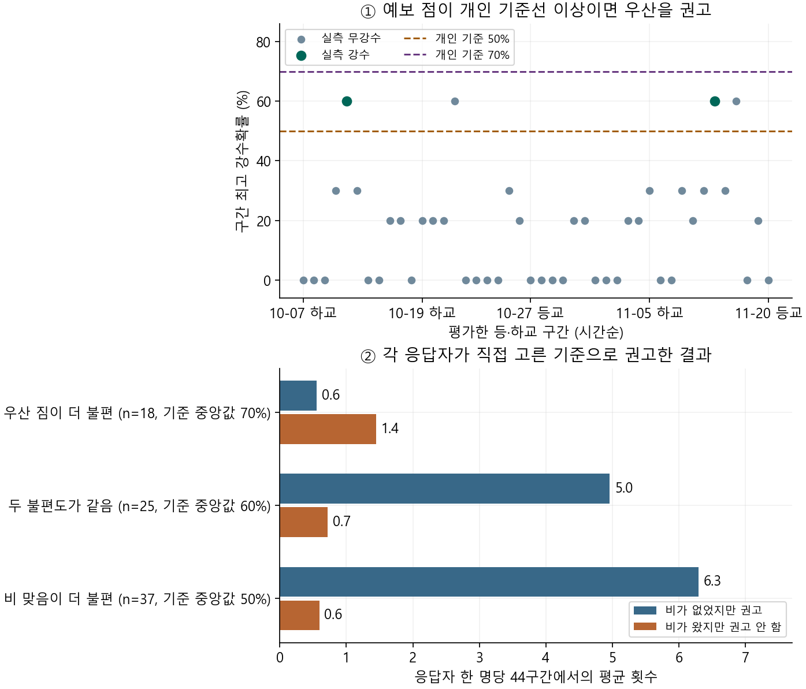

# 실제 예보에 개인별 우산 기준을 적용하면?
비 맞는 일을 더 꺼린 응답자는 설문에서 더 낮은 강수확률부터 우산을 챙긴다고 답했다. 같은 44개 외출 구간에 이 기준을 적용하면 이 집단은 비를 놓치는 횟수가 적지만, 비가 오지 않아도 우산을 권하는 횟수는 늘어난다.

| 평가 단위 | 기준 시점 | 답하는 질문 |
|---|---|---|
| 기존 836시간 | 대상 1시간 전 발표 기준 | 발표된 시간별 예보가 실측과 얼마나 일치했나? |
| 재평가 758시간 | 대상 1시간 전 실제 수집까지 완료 | 그때 보유한 시간별 예보로도 같은 평가가 가능한가? |
| 등·하교 44구간 | 출발 전 실제 수집 완료 | 개인별 기준으로 외출 전체에 우산을 권하면 어떤 오류가 생기나? |

44는 출발 시점과 집계 단위가 다른 별도 평가다. 예를 들어 10월 13일 등교 구간(08~09시) 최고 POP는 60%였고 실제 비가 왔다. 기준 50%는 지참을 권고하고 기준 70%는 권고하지 않는다. 10월 21일 등교도 예보는 60%였지만 실제로는 비가 오지 않았다.

## 결합 알고리즘
1. 출발 시각까지 실제 수집된 예보 중 각 대상 시간에 대한 최신 발표를 사용한다. 외출 종료까지 예보가 모두 있는 구간에서 시간별 POP의 최댓값을 구한다. 최댓값은 경보 지표이며 ‘한 번이라도 비가 올 확률’로 해석하지 않는다.
2. 설문 7번에서 응답자가 고른 지참 기준과 비교한다. 예보 최댓값이 개인 기준 이상이면 지참을 권한다. ‘항상 챙긴다’는 항상 권하며 ‘90% 이상’은 90%부터 적용한다.
3. 평가할 때만 해당 구간의 시간 강수량을 확인한다. 한 시간이라도 0 mm 초과면 비가 온 구간이다. 비가 안 왔는데 권하면 헛경보, 왔는데 권하지 않으면 놓침이다.
4. 불편도만 입력받는 대안도 비교했다. 기준(%) = 100 × 우산 짐 불편도 / (우산 짐 불편도 + 비 맞음 불편도). 두 1~5점 응답을 비용처럼 취급한 설명용 규칙이며, 최적 임계값으로 학습한 값은 아니다.

## 구간 평가
평일 08~09시와 17~19시를 가상의 등·하교로 설정했다. 정시 관측값을 직전 한 시간 누적으로 보고 각각 09시, 18·19시 값을 사용했다. 실측·예보가 모두 있는 구간만 사용했다. 총 28일에 등교 26회, 하교 18회가 남았으며 두 구간에서 각각 한 번 비가 왔다.

| 공통 기준 | 헛경보 / 무강수 42구간 | 놓침 / 강수 2구간 |
|---|---:|---:|
| 30% | 9 | 0 |
| 50% 또는 60% | 2 | 0 |
| 70% | 0 | 2 |

| 더 불편한 상황 | 응답자 | 직접 선택한 기준 중앙값 | 44구간당 평균 헛경보 | 평균 놓침 |
|---|---:|---:|---:|---:|
| 우산이 짐이 됨 | 18 | 70% | 0.6회 | 1.4회 |
| 두 상황이 같음 | 25 | 60% | 5.0회 | 0.7회 |
| 비를 맞음 | 37 | 50% | 6.3회 | 0.6회 |

각 응답자에게 동일한 예보 이력을 적용한 모의 결과다. 실제로 이 사람들이 등교했거나 비를 맞았다는 관측 기록은 없다. 이 기간 공통 60% 규칙도 헛경보 2회·놓침 0회였으므로 개인화가 예측 성능에서 우월하다는 주장은 하지 않는다.

## 시각 누출과 설문 민감도
기존 836시간은 발표 시각 기준 후향 평가다. 최종 예보 ZIP의 collected_at을 병합 키로 복원한 뒤 대상 시각 한 시간 전까지 수집된 예보만 허용하면 758시간, 강수 33시간, 강수일 8일이다. 실제 예보값별 표는 hourly_pop.csv에 있다. 60% 자체는 44시간이다. 비어 있는 40% 이상 60% 미만 구간에는 60%가 포함되지 않으며, 시간별 POP는 설문에 제시한 하루 전체 POP와도 구분한다.

같은 80명의 10분·60분 답을 비교해 고민 응답을 0, 0.5, 1로 바꿨을 때 평균 응답 점수 차이는 100점 환산 +31, +26, +21점이었다. 중간값 처리 시 응답자 재표집 95% 구간은 +18~+35점이다. 이는 응답 코딩에 대한 민감도이며 순서형 모델의 계수나 실제 행동 변화량은 아니다. 두 조건의 질문 순서가 고정되어 대비 효과를 분리할 수 없다. 가설 ③은 사후 탐색으로 표시한다. 기존 Holm 보정은 두 대응 비교에 적용한 것으로 세 가설 전체 보정이 아니다.

동일 GroupKFold 분할로 다시 비교한 Brier 변화(개인화−기준)의 조건부 95% 구간은 POP 50%에서 −0.042~+0.016, 60%에서 −0.030~+0.005였다. 두 구간 모두 0을 포함했다. 검증 예측을 고정하고 응답자 단위로 재표집해 얻은 범위이며 외부 검증을 대체하지 않는다.

## 발표 때 설명할 세 가지
- Holm 보정은 관련 비교를 여러 번 했을 때 우연히 유의한 결과를 고를 위험을 줄인다.
- GroupKFold는 한 사람의 두 답을 한 묶음에 넣어 학습 때 본 사람을 평가에서 다시 맞히는 문제를 막는다.
- Brier는 예측한 확률과 실제 0·1 응답 사이의 차이를 제곱해 평균낸 값이다. 작을수록 확률 예측이 정확하다.

설문 로지스틱 모델의 점수는 지참 의향이다. 개인별 임계값 알고리즘의 출력은 실제 예보에 대한 지참 권고다. 실제 효용을 검증하려면 외출별 행동과 만족도 기록이 필요하다.
