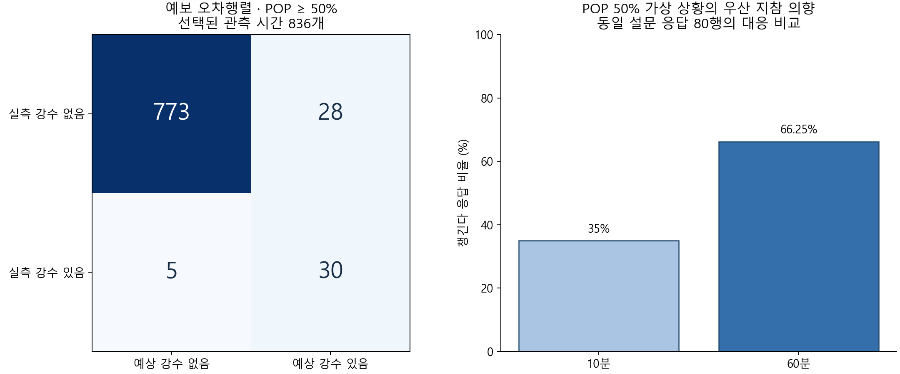
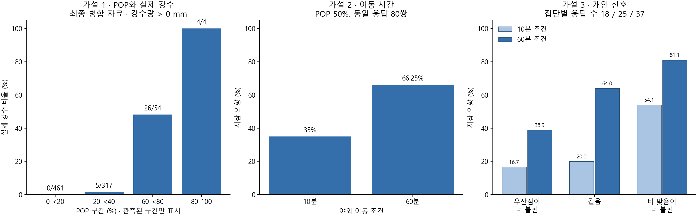

# 우산 지참 판단에 이동 시간과 개인 선호를 반영할 근거가 있는가?

[등·하교 개인 기준 재평가 — 836시간·758시간·44구간 비교 및 그래프](../commute_results/재평가.md)
2026년 11월 23일 · 배소현 담당 분석 · 최종 첨부자료 재계산

## 1. 강수확률과 실제 비
안산 AWS 545의 시간당 강수량이 0 mm를 초과하면 실제 강수로, 사동 격자의 예보 강수확률(POP)이 50% 이상이면 강수 예상으로 분류했다. 41개 발표일 예보 1,025행의 대상 시각·격자·발표 시각·POP·PCP·PTY를 병합 CSV와 대조했다. 같은 대상 시각에는 최소 1시간 전 발표 중 최신 예보를 선택해 중복 35행을 제거했다. 실측이 누락된 154시간을 제외한 평가 기간은 10월 7일 15시~11월 21일 23시 중 40일, 총 836시간이다. 비는 8일에 걸쳐 35시간 관측됐다. 발표 시각 기준의 후향 평가이며 실시간 서비스 성능은 미검증이다.

|예보 POP|실제 강수 / 평가 시간|실제 강수율|
|---|---:|---:|
|0~20% 미만|0 / 461|0%|
|20~40% 미만|5 / 317|1.58%|
|40~60% 미만|0 / 0|표본 없음|
|60~80% 미만|26 / 54|48.15%|
|80~100%|4 / 4|100%|

관측된 구간에서는 POP가 높을수록 강수가 잦았다. 다만 중간 구간은 비었고 최고 구간은 4시간뿐이다. 이 표를 다른 계절이나 지역에 적용할 확률 보정표로 사용하기에는 근거가 부족하다.



비 예보 58시간 중 30시간 적중, 28시간 헛경보(48.28%). 실제 비 35시간 중 5시간 놓침(14.29%). 무강수 적중은 773시간이었다. 정확도는 96.05%로, 모든 시간을 무강수로 분류한 95.81%와 가깝다. 비가 드문 자료에서는 두 오류율을 함께 봐야 한다.

## 2. 이동 시간과 이동 중 비 예보
학교 지인을 대상으로 한 편의표집 설문 80행을 모두 사용했다. 같은 응답 행 안에서 두 조건을 짝지었고 ‘챙긴다’를 1, ‘고민된다·챙기지 않는다’를 0으로 코딩했다. 원래 세 범주의 전환표는 결과 폴더에 보존했다. 정확 McNemar 양측 검정 두 건에 Holm 보정을 적용했다.

|조건 변화|지참 응답 전 → 후|변화|지참으로 전환 / 반대 전환|보정 p|
|---|---|---:|---:|---:|
|POP 50%, 이동 10분 → 60분|28/80 → 53/80|+31.25%p|25 / 0|5.96×10⁻⁸|
|전체 POP 60%, 이동 시간대 비 예상 없음 → 있음|31/80 → 66/80|+43.75%p|36 / 1|1.11×10⁻⁹|

동일한 강수확률에서도 야외에 머무는 시간이 길거나 이동 중 비가 예상되면 지참 의향이 높았다. 이동 시간을 입력받고 이동 시간대 예보를 표시할 근거가 있다. 설문이 제시한 10분과 60분 사이에서 지참 의향이 어느 시점에 바뀌는지는 확인할 수 없다.

## 3. 개인 선호와 지참 의향
같은 80행에서 우산이 짐이 되는 불편도와 비를 맞는 불편도를 비교했다. 한 사람의 두 답변을 묶어 선호 집단 순위와 두 조건에서 ‘챙긴다’고 답한 횟수의 Spearman 상관을 구했다.

|더 불편한 상황|응답 수|10분 지참|60분 지참|
|---|---:|---:|---:|
|우산이 짐이 됨|18|3/18 (16.7%)|7/18 (38.9%)|
|둘이 같음|25|5/25 (20.0%)|16/25 (64.0%)|
|비를 맞음|37|20/37 (54.1%)|30/37 (81.1%)|

비 맞음을 더 불편해하는 집단이 두 조건 모두에서 가장 자주 ‘챙긴다’고 답했다. ρ=0.398, 응답자 단위 양측 순열검정 10,000회 p=0.00040. 개인 선호와 지참 의향 사이의 관련성이며, 편의표집과 가상 상황이라는 한계가 있다.



## 4. 개인 선호를 추가한 로지스틱 회귀
POP 50% 문항 두 개로 80명 × 2조건의 지참 의향을 추정했다. 같은 응답자의 두 행을 같은 분할에 묶고, 두 모델에 동일한 5겹 교차검증을 적용했다. 표준화는 각 학습 분할에서만 수행했다.

|모델 입력|Brier 오차 ↓|정확도 ↑|ROC-AUC ↑|
|---|---:|---:|---:|
|이동 시간|0.2274|65.63%|0.6263|
|이동 시간 + 두 불편도|0.2082|68.13%|0.7452|

선호 정보를 더하자 확률 오차가 줄고 응답자를 구분하는 성능이 좋아졌다. 이 점수는 POP 50%, 이동 10분 또는 60분이라는 설문 조건에서 ‘챙긴다’고 답할 의향을 나타낸다. 실제 우산 사용 여부나 다른 날씨에서의 필요성을 평가하려면 외출별 행동 자료가 필요하다.

[최종 자료](https://app.notion.com/p/420234f14c7d803a98f9cff93f6e68c0) · [분석 참고안](https://app.notion.com/p/415234f14c7d8090ac9ccd7406fd1004)

## 5. 하루 강수확률 60%의 지참 의향 점수
같은 80명의 설문 3·4번에서 이동 시간대 비 예보(없음/있음)와 우산 짐·비 맞음 불편도(각 1~5)를 결합했다. 160건의 이진 응답(챙긴다=1)으로 로지스틱 회귀를 학습했다. 같은 사람의 두 응답을 묶어 동일한 5겹 분할로 평가했다.

| 모델 | Brier 오차 | ROC-AUC | 50점 기준 정확도 |
|---|---:|---:|---:|
| 이동 중 비 예보 | 0.203 | 0.648 | 71.9% |
| 이동 중 비 예보와 두 불편도 | 0.190 | 0.755 | 68.8% |

우산 짐 불편도 3점, 비 맞음 불편도 4점인 경우, 이동 중 비 예보가 없으면 43.78점, 있으면 86.43점이다. 개인 선호 추가 후 내부 검증에서 확률 오차와 구별 능력은 개선됐으나 50점 기준 정확도는 낮아졌다. 이 점수는 하루 강수확률 60%인 가상 상황에서의 지참 의향이다. 실제 강수 확률·실외 행동은 별도로 검증해야 한다.

### 재현
저장소 루트에서 requirements-analysis.txt의 의존성을 설치한 후 실행한다. 최종 예보 ZIP, 실측 병합 ZIP, 원본 설문 CSV는 팀 노션에서 내려받아 사용자 Downloads 폴더에 둔다.

```shell
python analyze_final.py
python rain_score.py
python rain_score.py --score 60 0 3 4
python rain_score.py --score 60 1 3 4
```

마지막 두 명령은 저장된 모델 계수를 사용하므로 원자료 없이 실행할 수 있다.
