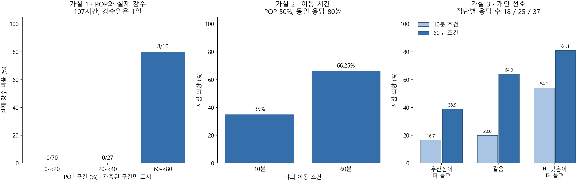

# 세 가설과 추천 알고리즘 연결 — 최종 정리

담당: 배소현 / 분석일: 2026-11-02

## 연구 목표와 범위

기상청 예보를 평가하고, 야외 이동 조건과 개인 선호를 반영하는 우산 지참 의향 알고리즘을 구현한다. 현재 설문은 실제 필요 여부의 정답이 아니므로 출력은 **제한된 설문 상황의 지참 의향 점수**로 정의한다. 실제 외출에서 추천이 유용했는지는 후속 검증 항목이다.

세 가설은 노션의 기존 가설을 구체화한 것이다. 아래의 검증 방법과 개인화 성능 비교는 자료를 확인한 뒤 정리했으므로 사전 등록한 확증 연구로 표현하지 않는다.



## 가설 1 — 예보 정보의 신뢰성

**강수확률이 높은 구간일수록 실제 강수 발생 비율이 높을 것이다.**

- 데이터: 노션의 예보·실측 병합 자료. POP, 실제 강수량, 누락 플래그, 발표 시각, 대상 날짜·시간·격자를 사용한다.
- 분석 단위: 같은 날짜·시간·격자의 관측 1개. 동일 대상 시간의 발표 중복을 정리하고 누락 실측은 제외한다.
- 방법: POP 구간별 실측 강수 발생 비율을 비교한다. POP 50% 기준 오차행렬, 헛경보 비율, 놓침률은 예보 평가의 보조 지표로 사용한다. 임계값 민감도를 확인하되 같은 자료로 최적 임계값을 확정하지 않는다.
- 결과: 최종 107시간 중 POP 0~20% 미만은 0/70, 20~40% 미만은 0/27, 60~80% 미만은 8/10에서 강수가 발생했다. 40~60% 미만과 80~100%는 자료가 없다. 오차행렬은 [[97,2],[0,8]]이다.
- 해석: 높은 POP 구간에 강수가 집중되는 방향이 관찰됐다. 강수 8시간이 모두 10월 13일에 있어 일반적 관계나 확률 보정의 타당성은 확정할 수 없다.
- 알고리즘 반영: **원래 POP를 유지한다.** 60%를 80%로 바꾸는 식의 보정은 하지 않는다. 추후 여러 강수일을 확보하면 보정 모델을 별도 학습·검증한다.
- 판정: **현재 표본에서 방향 관찰 / 일반화·보정 검증 보류.**

## 가설 2 — 야외 노출 시간

**같은 강수확률 조건에서 야외 이동 시간이 긴 경우, 우산을 챙기겠다는 응답 비율이 높을 것이다.**

- 데이터: 설문 Q1(POP 50%·10분)과 Q2(POP 50%·60분)의 동일 응답 80쌍.
- 분석 단위: 응답자 1개. 160개 질문 응답을 160명의 독립 표본으로 취급하지 않는다.
- 방법: 챙긴다=1, 챙기지 않는다/고민된다=0으로 정의하고 정확 McNemar 검정으로 대응 선택의 차이를 비교한다. 원래 3범주 분포는 보존한다. '고민된다' 제외 모델도 민감도 분석으로 따로 계산한다.
- 결과: 10분 28/80=35.00%, 60분 53/80=66.25%, 차이 +31.25%p. 챙긴다로 전환 25개, 반대 전환 0개. 정확 p=5.9605×10⁻⁸. 이동 시간대 강수 여부의 보조 비교와 함께 Holm 보정해도 p=5.9605×10⁻⁸이다.
- 알고리즘 반영: **야외 이동 시간을 모델 입력에 포함한다.** 측정된 10분·60분에서 점수를 계산하고, 미측정 시간에 대한 보간·외삽이나 15분 추천 기준은 적용하지 않는다.
- 보조 분석: 전체 POP 60%에서 이동 시간대 강수 없음/있음 조건의 지참 의향은 38.75%/82.50%, 보정 p=1.1059×10⁻⁹이다. 알고리즘 입력은 하루 전체 예보보다 실제 이동 시간·지역의 예보를 먼저 선택하도록 인터페이스를 구성했다. 이 보조 문항에는 구체적인 시간대 POP가 없으므로 0%/100%로 임의 변환하지 않는다.
- 판정: **해당 가상 설문 두 조건에서 지지 / 연속적인 시간 기준은 미확정.**

## 가설 3 — 개인 선호와 개인화

**우산짐보다 비 맞음을 더 불편하게 여기는 응답 집단일수록, 같은 예보·이동 조건에서 우산 지참 의향이 높을 것이다.**

알고리즘 적용 질문은 **“개인 불편도를 추가하면 이동 시간만 사용할 때보다 새로운 응답자의 지참 의향 예측이 개선되는가?”**로 구체화한다.

- 데이터: 설문 Q5·Q6의 두 불편도와 Q1·Q2 지참 응답, 동일 원본 80행.
- 비교: 우산짐이 더 불편 / 같음 / 비 맞음이 더 불편의 순서형 세 집단으로 구분한다. 점수를 금전적 비용처럼 나누거나 차이가 같은 효용을 뜻한다고 가정하지 않는다.
- 관련성 분석: 두 조건의 지참 선택 평균을 응답자마다 1개 값으로 만들고, 선호 집단 순서와의 Spearman 관련성을 계산한다. 두 응답을 묶은 채 응답자 단위로 10,000회 순열해 탐색적 양측 p값을 계산한다.
- 결과: 집단별 지참 비율은 아래 표와 같다. 응답자 단위 ρ=0.3984, 탐색적 순열 p=0.000400이다. 이는 관찰된 관련성이고 선호의 인과 효과는 아니다. p값은 가설 2의 두 비교에 대한 Holm 보정과 별개의 탐색적 값이다.

| 선호 집단 | 응답 수 | 10분 조건 | 60분 조건 |
|---|---:|---:|---:|
| 우산짐이 더 불편 | 18 | 16.67% | 38.89% |
| 두 불편도가 같음 | 25 | 20.00% | 64.00% |
| 비 맞음이 더 불편 | 37 | 54.05% | 81.08% |

- 예측 비교: 동일한 응답자 단위 5분할에서 이동 시간만 사용한 모델과 두 불편도를 더한 로지스틱 회귀를 비교한다. 표준화는 학습 분할에서만 계산한다.
- 기본 분할 결과: 정확도 65.63%→68.13%, Brier 오차 0.2274→0.2082. Brier는 확률 예측의 제곱 오차이며 낮을수록 좋다.
- 분할 민감도: seed 42~61의 동일한 20가지 5분할에서 개인화의 평균 정확도 차이는 +2.91%p, 범위 -1.25~+4.375%p였다. 평균 Brier 개선은 0.01617이며 20회 모두 낮아졌다(개선 범위 0.01196~0.02161).
- 해석: 개인화 입력의 활용 가능성은 관찰됐지만 정확도가 모든 분할에서 개선되지는 않았다. 20회는 **같은 80행을 재분할한 결과**이며 표본 1,600명·독립 실험 20개·신뢰구간·성능 우위의 확증 근거로 표현하지 않는다.
- 알고리즘 반영: **두 불편도를 학습된 입력으로 사용한다.** 새 사용자의 두 불편도를 받아 동일한 날씨·시간에서도 개인화된 의향 점수를 계산한다. 1~5점 척도를 모델에 수치 입력한 것은 탐색적 선형 효과 가정이다. 서열형 집단 비교가 이 가정을 검증해 주는 것은 아니다.
- 판정: **표본 내 관련성 및 예측 개선 가능성 관찰 / 외부 성능과 실제 효용은 미검증.**

## 세 가설을 코드에 연결한 방식

1. 사용자 이동 시간·지역에 맞는 예보를 상위 단계에서 선택한다. `recommend_from_travel_forecasts`는 이 선택 확인을 필수로 받는다. 실제 이동 구간 선택을 수행하는 실시간 서비스는 이번 분석 범위에 포함되지 않는다.
2. 가설 1에 따라 POP를 보정하지 않고 그대로 전달한다.
3. 가설 2에 따라 야외 이동 시간을 점수 입력으로 사용한다. 이동 시간대 예보 확인 없이 하루 POP만 넣으면 점수를 반환하지 않는다.
4. 가설 3에 따라 우산짐·비맞음 불편도를 개인화 입력으로 사용한다.
5. 현재 측정 영역인 POP 50%·이동 10분/60분에서만 점수를 반환한다. 여러 시간대 POP가 다르거나 다른 POP이면 점수를 만들지 않는다. 눈·혼합 강수는 별도 지원 범위로 남긴다.
6. 0~100점의 의향 점수를 출력하며 실제 필요 확률·자동 지참 지시·검증된 추천 임계값으로 표현하지 않는다. 기존 임시 `recommend_umbrella`와 혼용하지 않는다.

현재 병합 자료의 POP는 0·20·30·60·70%이므로 실제 제공 예보 전체는 학습한 POP 50% 범위 밖이다. 따라서 이번 자료에서 **실제 예보에 대한 최종 의향 점수까지 검증한 것은 아니다.** 현재 통합 인터페이스는 범위 밖을 명시적으로 알리는 동작까지 완성한 것이다.

```python
import json
from pathlib import Path
from src.recommendation import recommend_from_travel_forecasts

model = json.loads(Path('results/sohyun/intention_model.json').read_text(encoding='utf-8'))
answer = recommend_from_travel_forecasts(
    [{'POP': 50, 'PTY': 0}], model,
    outdoor_minutes=10, carry_discomfort=4, wet_discomfort=4,
    travel_window_confirmed=True)
# 설문 조건을 재현한 계산 예시: score=31.32, 실제 필요도 검증 결과가 아님
```

## 제출 상태와 남은 의사결정

가설별 데이터·방법·결과·알고리즘 반영 사항, 분석 코드, 모델 파일, 20회 분할 민감도, 실행 예시, 테스트와 AI 사용 기록을 로컬 제출본에 정리했다. 테스트는 16개 통과했다. 원자료와 개인별 예측값을 새 공개 파일에 포함하지 않았다.

추가 연결 자료를 생성하거나 관측하지 않은 결과를 만들어 완료로 표시하지 않는다. 실제 외출 사건별 자료 확보와 외부 검증은 후속 과제다. GitHub 작업 브랜치에 업로드하고 [PR #3](https://github.com/shuu-uz/UmbrellAI/pull/3)을 생성했다. [노션 9주차 페이지](https://app.notion.com/p/9-407234f14c7d800d95f5e633735e0f74)에 최종 결과를 게시하고 저장을 확인했다. PM의 검토와 main 병합은 대기 중이다.

AI 활용 추가 요청 원문: “그럼 가설 3가지 정리해주고 그걸 바탕으로 내가 할일 다 끝내줘”. 보완 작업은 관련성 순열검정, 모델 분할 민감도, 알고리즘 연결 인터페이스 및 최종 문서 작성이다.

## 근거와 재현

- [전체 분석 결과 및 입력 출처](sohyun_results_20261102.md)
- 코드: `src/run_analysis.py`, `src/intention_model.py`, `src/recommendation.py`
- 결과: `results/sohyun/survey_metrics.json`, `personalization_stability.csv`, `weather_metrics.json`
- 버전·입력 해시: `results/sohyun/provenance.json`
- 실행: 기존 보고서의 명령으로 분석을 다시 실행하면 보완 분석도 함께 재계산한다.
- 검증: `python -m unittest discover -s tests -v`
