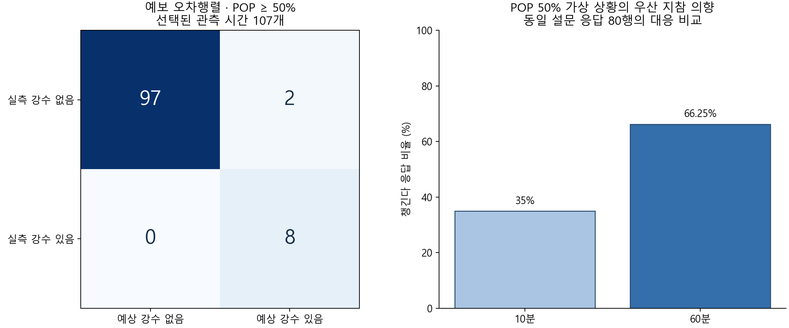

# 배소현 담당 분석 결과 — 2026-11-02

최종 가설·데이터·분석·알고리즘의 연결은 [세 가설 최종 정리](hypotheses_and_algorithm.md)에 정리했다.

## 완료한 작업과 결과 범위

노션에 첨부된 예보·실측 병합 CSV 125행과 깃허브 설문 브랜치의 응답 80행을 사용해 예보 평가, 가설별 분석, 로지스틱 회귀 학습과 내부 검증을 수행했다. 실행 코드는 `src/run_analysis.py`, 점수 계산 코드는 `src/intention_model.py`에 작성했다.

현재 산출하는 점수는 **설문에 제시된 상황에서의 우산 지참 의향 점수**다. 실제 우산 필요 여부나 만족도를 측정한 정답이 없으므로 실제 필요 확률로 해석하지 않는다. 기상청 예보 성능과 설문 의향 모델 성능도 서로 다른 결과다.



## 1. 사용 데이터와 평가 대상

| 구분 | 확인 내용 |
|---|---|
| 예보·실측 | 노션 7주차의 `merged_forecast_actual.csv`, 125행·16열 |
| 기간·지역 | 2026-10-07~10-14, 격자 nx=58·ny=121. 팀 설명상 안산 AWS 545 실측 |
| 발표 중복 | 동일 대상 시간에 서로 다른 발표가 있는 3행을 최신 발표로 대체 |
| 선택 후 | 대상 시간 122개 |
| 실측 누락 제외 | rain_missing=1인 15개 제외. 0mm로 간주하지 않음 |
| 최종 평가 | 107개 관측 시간: 무강수 99개·강수 8개 |
| 설문 | `feat/survey-analysis`의 정리된 응답 80행·16열 |

발표 선택은 **대상 시간 1시간 전을 임시 판단 시각으로 두고, 그 시각 이하인 제공 자료의 발표 중 가장 최근 것**을 선택했다. 모든 발표를 독립 관측처럼 합산하지 않았다. 이는 이번 분석의 명시적 가정이며 팀의 확정 운영 기준은 아니다. `collected_at`이 없어 해당 시점에 실제 수집·이용할 수 있었는지는 검증하지 못했다. 시간대는 팀 문서에 따라 한국 시간으로 해석했다.

AWS 원시 파일과 관측소-격자 대응표·시간당 강수 집계 정의는 이 자료에 포함되지 않았다. 원자료의 정확성은 독립 검증하지 않았으며 제공된 병합 결과와 누락 플래그를 기준으로 분석했다. `temp`, `humidity`는 관측값이므로 예측 모델 입력에 넣지 않았다. `1mm 미만`을 0.5mm로 대체한 5행은 기존 전처리의 가정이며 POP 평가와 설문 모델에는 사용하지 않았다.

## 2. 기상청 예보 평가

기존 분석 초안의 임시 기준을 유지해 POP ≥ 50%를 강수 예상, 실측 강수량 > 0mm를 강수 발생으로 정의했다. 행은 실측, 열은 예상이다.

| 실측 / 예상 | 강수 없음 | 강수 있음 |
|---|---:|---:|
| 강수 없음 | TN=97 | FP=2 |
| 강수 있음 | FN=0 | TP=8 |

- 헛경보 비율: FP/(TP+FP) = 2/10 = **20.00%**
- 거짓 양성률: FP/(TN+FP) = 2/99 = **2.02%**
- 놓침률: FN/(TP+FN) = 0/8 = **0.00%**
- 정확도: (TP+TN)/107 = 105/107 = **98.13%**

98.13%는 이 표본의 기술 통계다. 무조건 무강수라고 예측해도 99/107=92.52%가 되므로 정확도만 강조하지 않는다. **강수 8시간이 모두 10월 13일에 몰려 있어 독립적인 여러 강수 사례를 검증한 결과가 아니다.** 놓침률 0%를 향후에도 비를 놓치지 않는다는 의미로 사용하지 않는다.

### POP 기준 민감도

| 기준 | TN | FP | FN | TP | 헛경보 비율 | 놓침률 |
|---|---:|---:|---:|---:|---:|---:|
| 20% | 70 | 29 | 0 | 8 | 78.38% | 0% |
| 30% | 85 | 14 | 0 | 8 | 63.64% | 0% |
| 50% | 97 | 2 | 0 | 8 | 20.00% | 0% |
| 60% | 97 | 2 | 0 | 8 | 20.00% | 0% |
| 70% | 99 | 0 | 6 | 2 | 0% | 75.00% |

50%와 60% 사이의 POP 관측값이 없어서 두 기준의 결과가 같다. 같은 자료를 보고 50%나 60%가 최적이라고 결정하지 않았다. 설문에서 제안된 60%도 사용자 선호의 초기 후보이며 예보 최적 기준과는 의미가 다르다.

## 3. 가설별 분석

### 가설 1: 강수확률이 높을수록 실제 강수 비율이 높다

| POP 구간 | 평가 시간 수 | 강수 시간 수 | 실제 강수 비율 |
|---|---:|---:|---:|
| 0% 이상 20% 미만 | 70 | 0 | 0% |
| 20% 이상 40% 미만 | 27 | 0 | 0% |
| 40% 이상 60% 미만 | 0 | 0 | 계산 불가 |
| 60% 이상 80% 미만 | 10 | 8 | 80% |
| 80~100% | 0 | 0 | 계산 불가 |

현재 표본에서는 높은 POP 구간에서 강수가 집중되는 방향이 관찰됐다. 빈 구간과 단일 강수일 때문에 전 구간의 보정 정확도나 일반적인 단조 관계를 확정하지 않는다.

### 가설 2: 같은 예보에서 야외 이동 시간이 길수록 지참 의향이 높다

POP 50% 조건에서 10분 이동 시 챙긴다는 응답은 28/80=35.00%, 60분 이동 시에는 53/80=66.25%로 **31.25%p 증가**했다. 챙긴다로 전환한 응답은 25개, 반대 전환은 0개였다.

동일 응답의 이진 선택을 비교하므로 독립표본 T-test 대신 **정확 McNemar 검정**을 사용했다. 챙긴다=1, 챙기지 않는다/고민된다=0으로 정의했다. p=5.9605×10⁻⁸이며 두 시나리오 비교에 대한 Holm 보정 후에도 같은 값이다. 이 결과는 가상 상황의 응답 차이이며 실제 체류 시간이나 실제 지참 행동의 인과 효과는 아니다.

추가로 전체 POP 60% 조건에서 이동 시간에 비가 없는 경우 31/80=38.75%, 비가 있는 경우 66/80=82.50%였다. 전환은 증가 36개·감소 1개, 정확 McNemar p=5.5297×10⁻¹⁰, Holm 보정 p=1.1059×10⁻⁹였다. 다연님 분석 보고서의 해당 수치와 재계산 결과가 일치했다.

### 가설 3: 비 맞음과 우산짐 불편도에 따라 선택이 달라진다

| 불편도 응답 집단 | 응답 수 | 10분 조건 지참 | 60분 조건 지참 |
|---|---:|---:|---:|
| 비 맞음이 더 불편 | 37 | 20/37=54.05% | 30/37=81.08% |
| 두 불편도가 같음 | 25 | 5/25=20.00% | 16/25=64.00% |
| 우산짐이 더 불편 | 18 | 3/18=16.67% | 7/18=38.89% |

응답 집단별 차이가 관찰돼 두 불편도를 모델의 탐색적 입력으로 사용했다. 개인 선호 세 집단의 순서와 응답자별 두 조건 평균 지참 의향의 관련성을 추가 분석했다. 응답자 단위 Spearman ρ=0.3984, 10,000회 순열의 탐색적 양측 p=0.000400이었다. 이는 자료 확인 후 수행한 탐색 분석이며 가설 2의 두 시나리오에 대한 Holm 보정과 별개다. 선호 집단 순서를 사용해 불편도를 금전적 비용 비율로 바꾸지 않았다. 관련성이 관찰됐지만 인과 효과나 실제 행동에 미치는 영향을 확정하지 않는다.

## 4. 로지스틱 회귀와 점수 산출

학습에는 Q1·Q2의 80응답×2조건=160행을 사용했다. 입력은 야외 이동 시간, 우산짐 불편도, 비맞음 불편도다. 목표는 챙긴다=1, 나머지=0이다. POP는 두 질문 모두 50%로 일정하므로 계수를 학습하지 않았고 예상 강수량도 이 질문에서 측정되지 않았다.

기상 자료와 설문은 대응하는 날짜·지역·응답자 연결 키가 없다. 무작위 연결이나 곱집합으로 가짜 정답 행을 만들지 않았다. 따라서 **변하는 기상 변수와 사용자 변수를 통합한 실제 필요도 모델 학습은 미완료**이며 이 점수와 구분한다.

응답 행마다 임시 응답자 ID를 부여하고 같은 응답의 두 시나리오를 한 묶음으로 유지했다. 5분할 StratifiedGroupKFold로 응답자 단위 학습/검증을 분리했으며 모든 분할의 겹침은 0개였다. 고유 식별자가 없어 서로 다른 원본 행의 반복 제출 여부는 확인할 수 없다. 표준화는 각 학습 분할 안에서만 수행했고 L2 로지스틱 회귀(C=1, random_state=42)를 사용했다. 튜닝 없이 분할 밖 예측을 모아 계산했다.

| 내부 검증 모델 | 정확도 | 균형 정확도 | ROC-AUC | Brier 점수(낮을수록 좋음) |
|---|---:|---:|---:|---:|
| 학습 분할의 지참 비율만 사용하는 기준선 | 45.63% | 45.50% | 0.4450 | 0.2514 |
| 이동 시간만 사용 | 65.63% | 65.63% | 0.6263 | 0.2274 |
| 이동 시간+두 불편도 | **68.13%** | **68.14%** | **0.7452** | **0.2082** |

기본 분할에서 개인화 모델 정확도는 시간만 사용한 모델보다 2.50%p 높았다. seed 42~61의 20가지 동일 응답자 단위 분할로 보완했을 때 평균 정확도 차이는 +2.91%p(분할 간 범위 -1.25~+4.375%p), 평균 Brier 개선은 0.01617(범위 0.01196~0.02161)이었다. 확률 오차는 20회 모두 낮아졌으나 정확도는 일부 분할에서 낮아졌다. 같은 80행을 재분할한 결과로, 범위는 신뢰구간이 아니며 외부 일반화 성능을 입증하지 않는다. 학습 분할별 지참 비율이 50% 주변에서 달라져 비율 기준선의 정확도가 50% 미만일 수 있다.

‘고민된다’ 24개 시나리오 응답을 제외한 민감도 분석은 76응답·136행이며 정확도 71.32%, ROC-AUC 0.7340, Brier 0.2046이었다. 평가 대상과 정답 정의가 달라져 본 결과보다 우수하다고 직접 비교하지 않는다.

### 점수 정의와 사용 예

전체 160행으로 다시 학습한 모델의 표준화 계수와 평균·척도를 JSON으로 저장했다. 점수는 `100 × sigmoid(z)`이며 `z = 0.0217385 + 0.697259×(분-35)/25 - 0.554050×(우산짐-3.9)/1.102270 + 0.571480×(비맞음-4.125)/1.197654`이다. 정확한 계수는 `results/sohyun/intention_model.json`을 사용한다.

입력 불편도가 모두 4점인 **계산 예시**에서 POP 50%·10분은 31.32점, POP 50%·60분은 64.77점이다. 예시 입력으로 계산한 모델 출력이며 새로 측정한 응답이나 검증 성능이 아니다.

점수 함수는 측정한 조건인 **POP 50%, 이동 10분 또는 60분**만 받는다. 다른 POP나 30분 같은 미측정 시간에는 `outside_survey_domain`과 `score=None`을 반환한다. 0~100점은 지참 의향의 탐색적 모델 출력이며 신뢰도·실제 강수 확률·실제 필요 확률이 아니다. 기존 `recommend_umbrella`는 별도의 임시 규칙이고 이번 학습으로 검증된 규칙으로 바꾸지 않았다.

### 가설을 연결한 호출 인터페이스

`src/recommendation.py`의 `recommend_from_travel_forecasts`를 추가했다. 이동 시간·지역의 예보 선택 확인, 원래 POP 유지, 측정 시간 입력, 두 불편도 입력을 연결한다. 미지원 POP·시간, 눈/혼합 강수, 예보 부족에는 점수를 반환하지 않는다. 기존 임시 15분 기준을 호출하지 않는다. `results/sohyun/recommendation_examples.json`은 관측 성능이 아닌 입력별 계산 예시다. 제공된 실제 예보에는 POP 50%가 없어 실제 예보의 지참 점수까지 검증한 것은 아니다.

## 5. 재현 방법과 검증

저장소 루트에서 다음과 같이 실행한다. 원본 데이터는 기존 저장소 방침에 따라 새로 커밋하지 않았다.

```sh
python -m pip install -r requirements-analysis.txt
# 노션 7주차의 첨부를 data/merged_forecast_actual.csv로 저장
# 아래 설문 파일은 지정 커밋에서 가져온다. 기존 파일이 있으면 비교 후 사용한다.
python -c "import pathlib,subprocess; p=pathlib.Path('work_inputs/survey_analysis/cleaned_responses.csv'); p.parent.mkdir(parents=True,exist_ok=True); p.write_bytes(subprocess.check_output(['git','show','88d24e2636e76b2c5506c40185409efb22f068a5:survey_analysis/cleaned_responses.csv']))"
python -m src.run_analysis --weather data/merged_forecast_actual.csv --survey work_inputs/survey_analysis/cleaned_responses.csv --out results/sohyun
python -m unittest discover -s tests -v
```

점수 호출 예시는 다음과 같다.

```python
import json
from pathlib import Path
from src.intention_model import intention_score
model = json.loads(Path('results/sohyun/intention_model.json').read_text(encoding='utf-8'))
print(intention_score(model, pop=50, outdoor_minutes=10,
                      carry_discomfort=4, wet_discomfort=4))
```

- 기존 6개+추가 10개, **16개 자동 테스트 통과**. 합성 테스트는 코드 정확성 검사이며 실측 성능 자료가 아니다.
- 별도의 표준 라이브러리 CSV 재집계로 TN=97·FP=2·FN=0·TP=8을 확인했다.
- 실제 입력으로 전체 분석을 실행했으며, JSON 점수와 scikit-learn 모델의 출력을 학습 입력 160행 모두에서 비교해 반올림 오차 0.005점 이내임을 확인했다.
- 결과 그림을 열어 값·축·한글·잘림 여부를 확인했다.
- 입력 SHA-256, 라이브러리 버전과 출처는 `results/sohyun/provenance.json`에 기록했다. 개인별 예측값·설문 원본·실측 행별 파생 CSV는 새로 공개하지 않는다.

## 6. 남은 작업

이번 자료로 가능한 예보 평가·가설 분석·제한된 지참 의향 모델·결과 정리는 완료했다. 다음 항목은 추가 자료나 팀 결정이 필요하다.

1. 실제 외출 사건별로 발표/수집 시각, 이동 시간·지역, 예보 POP·PCP, 사용자 불편도, 실제 지참 행동·강수 노출·만족도를 함께 수집한다. 현재 자료에는 이 연결이 없다.
2. 여러 강수일과 무강수일을 확보한 뒤 날짜/강수 사건을 나눈 시간순 외부 검증을 수행한다.
3. 추천 판단 시점, AWS 시간 집계 구간·누락 의미·격자 대응을 담당자와 확정한다.
4. PM이 PR을 검토해 main에 병합한다. 다른 담당자의 열린 PR은 이 작업에서 병합하지 않는다.

## 7. AI 활용 기록

도구: Codex. 사용자 요청 원문: “그럼 깃허브 상태도 한번 확인해주고 내가 해야할일 지금끝내자.”

AI가 수행한 작업: 기존 브랜치·노션 요구사항 확인, 첨부 자료 읽기, 예보 선택·제외 기준 구현, 가설 검정 재계산, 응답자 묶음 검증을 적용한 로지스틱 회귀 구현, 테스트와 보고서 초안 작성. 별도로 사람이 입력하지 않은 프롬프트를 실제 사용 원문처럼 만들어 기록하지 않았다. AI가 만든 코드와 설명은 실행 결과와 독립 재집계로 점검했으며, 원자료의 관측 정확성이나 설문의 대표성까지 검증한 것은 아니다.

## 출처

- [역할 분담](https://app.notion.com/p/3f2234f14c7d80719431c5a904b0716c)
- [7주차 지시·병합 CSV 첨부·전처리 설명](https://app.notion.com/p/7-3f9234f14c7d80e3b958fc365d0de062)
- [분석 가설](https://app.notion.com/p/3f9234f14c7d8059a06fd0535db19ea3)
- [9주차 결과 정리 지시](https://app.notion.com/p/9-407234f14c7d800d95f5e633735e0f74)
- [설문 응답·분석 브랜치의 지정 커밋](https://github.com/shuu-uz/UmbrellAI/tree/88d24e2636e76b2c5506c40185409efb22f068a5/survey_analysis)
- [기존 소현 분석 코드](https://github.com/shuu-uz/UmbrellAI/tree/2c350d778bea147789c84c2af38a7e64442be2ce)
